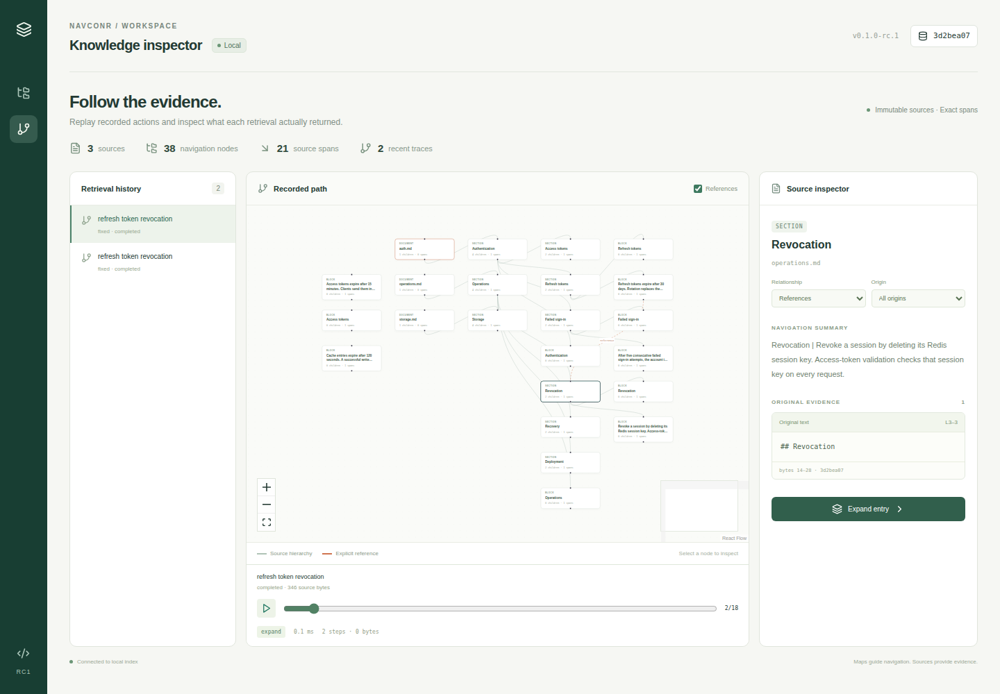

# Navconr

**Give your agent a map before it reads the documents.**

Navconr helps AI agents find their way through collections of documents and code. It builds a small, browsable map of your files, lets an agent explore the relevant sections, and returns the exact source passages it chooses to read.

Think of a table of contents that connects related ideas across files and can open the original text behind each entry.

```text
Your files → A lightweight map → Explore relevant sections → Read exact evidence
```

[Technical README](README.technical.md) · [Documentation](docs/README.md) · [Contributing](CONTRIBUTING.md) · [MIT license](LICENSE)

## What you can do

- **Explore a collection in small steps.** Browse sources, open sections, search, and follow links without loading everything into an agent's context.
- **Read the actual source.** Retrieved passages preserve the indexed text and identify its version and location.
- **Set limits.** Put bounds on source bytes, navigation steps, elapsed time, and optional model usage.
- **See the journey.** Inspect source and topic maps, relationships, retrieved passages, and recorded actions in the local viewer.
- **Use your own agent.** Start with the Python library or CLI, or connect through MCP and LangGraph/LangChain integrations.

Navconr supports Markdown, plain text, text-based PDF pages, Python, TypeScript/TSX, HTML, DOCX, and notebook source cells. See the [format guide](docs/ADAPTERS.md) for extraction limits.

## Try it

You need Git, Python 3.11 or newer, and [uv](https://docs.astral.sh/uv/getting-started/installation/). Install from source:

```bash
git clone https://github.com/Twilight-Techy/navconr.git
cd navconr
uv sync --locked
uv run navconr ingest examples/corpus --db .navconr/demo.sqlite
uv run navconr query "refresh token revocation" --db .navconr/demo.sqlite
```

The query returns source evidence, its revision, usage, a stop reason, and a record of the actions taken. This example runs locally without model credentials. To explore your own files, replace `examples/corpus` with a directory you want to index.

## Open the inspector

With Node.js 22 and npm installed, prepare a sample topic map and build the viewer:

```bash
uv run python scripts/prepare_demo.py
npm --prefix viewer ci
npm --prefix viewer run build
uv run navconr serve --db .navconr/demo.sqlite
```

Open [localhost:8765](http://127.0.0.1:8765). You can browse sources and topics, inspect relationships, read exact passages, and replay the prepared retrieval. Stop the server with Ctrl-C.



## Build with Navconr

The [technical README](README.technical.md) covers the architecture, Python examples, navigation tools, search options, budgets, integrations, and development workflow. The [API guide](docs/API.md) goes deeper into the contracts.

The library works without an LLM. Model-directed navigation, enrichment, and answer synthesis are optional and require an explicitly configured provider.

## Project status

Navconr is an early release candidate (`0.1.0rc1`), available here as source. The library, inspector, integrations, and local software checks are implemented. Live-model validation and independent research evaluation remain pending. The preliminary paper and authored test results do not establish a quality or efficiency advantage over other retrieval methods.

See [current status](docs/STATUS.md) and [evaluation notes](docs/EVALUATION.md) for the evidence and remaining work.

## Contribute

Bug reports, documentation improvements, format adapters, and retrieval experiments are welcome. Start with the [contribution guide](CONTRIBUTING.md), or [open an issue](https://github.com/Twilight-Techy/navconr/issues).

## License

Navconr is open source under the [MIT license](LICENSE).
