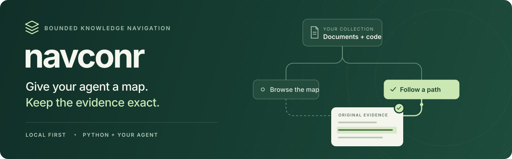
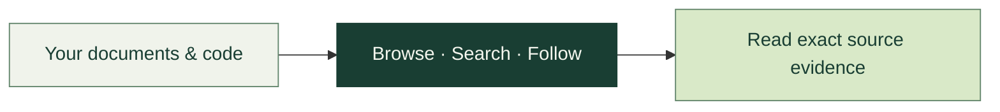
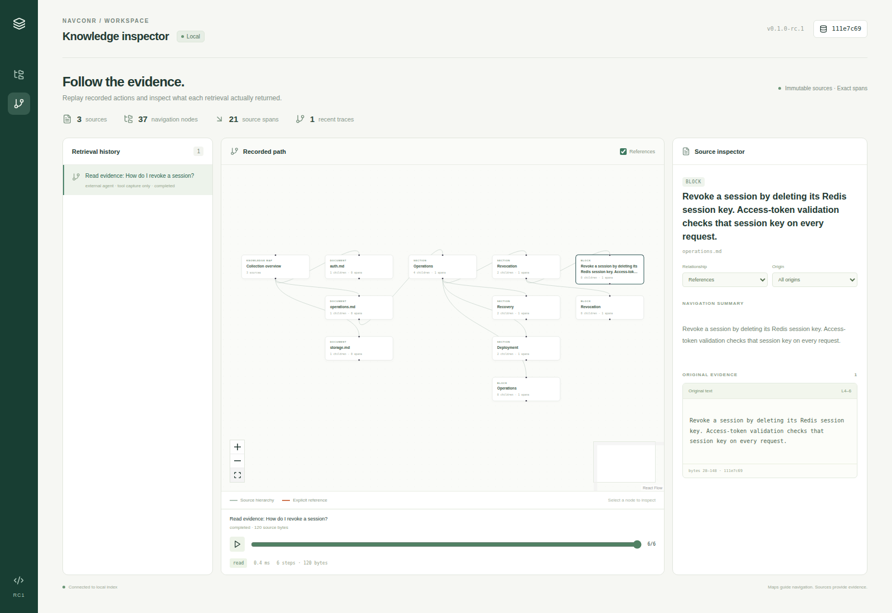

<p align="center">
  
</p>

<h1 align="center">Navconr</h1>

<p align="center">
  A navigable map of your documents and code.<br>
  <strong>Explore in small steps. Read the original source.</strong>
</p>

<p align="center">
  <a href="https://github.com/Twilight-Techy/navconr/actions/workflows/checks.yml"></a>
  <a href="pyproject.toml"></a>
  <a href="LICENSE"></a>
  <a href="docs/STATUS.md"></a>
</p>

<p align="center">
  <a href="#try-it">Quickstart</a> ·
  <a href="#see-the-journey">Inspector</a> ·
  <a href="README.technical.md">Technical guide</a> ·
  <a href="docs/README.md">Documentation</a> ·
  <a href="CONTRIBUTING.md">Contribute</a>
</p>

---

Navconr is a Python library that helps AI agents find their way through collections of documents and code. Think of a table of contents that connects related ideas across files and opens the original text behind each entry.

**Embed it in your existing project.** Keep your model client, credentials, request format, and agent loop. Use the library's tools directly, or connect your own model call to its optional controller. [Integration guide →](docs/INTEGRATION.md)

## How it works



Maps help the agent choose where to look. Reads return the indexed source text, with its version and location. The library works locally without an LLM; model-directed navigation is optional.

| Explore with control | Keep the evidence traceable |
| --- | --- |
| **Small steps.** Browse sources, expand sections, and follow links within a bounded map. | **Exact passages.** Retrieve original text tied to an immutable source revision. |
| **Explicit limits.** Bound source bytes, navigation steps, time, and optional model usage. | **Visible actions.** Inspect relationships, source reads, and recorded retrieval paths. |
| **Your agent.** Use Python, the CLI, MCP, or LangGraph/LangChain integrations. | **Local storage.** Keep the index and source snapshots in SQLite. |

## Try it

You need Git, Python 3.11 or newer, and [uv](https://docs.astral.sh/uv/getting-started/installation/). Install from source:

```bash
git clone https://github.com/Twilight-Techy/navconr.git
cd navconr
uv sync --locked
uv run navconr ingest examples/corpus --db .navconr/demo.sqlite
uv run navconr query "refresh token revocation" --db .navconr/demo.sqlite
```

The query returns source evidence, its revision, usage, a stop reason, and a record of the actions taken. This example runs locally without model credentials. To explore your own files, replace `examples/corpus` with a directory you want to index.

## See the journey

Browse the source and topic maps, follow relationships, inspect exact passages, and replay recorded retrievals.

<p align="center">
  <a href="reports/haiku-tool-inspector.png"></a>
  <br>
  <sub>A real Haiku-issued read → recorded tool activity → original evidence. Click to enlarge.</sub>
</p>

Captured on the sample documents with application-prepared navigation context and one model-issued `navconr_read` call. [View the run receipt](reports/haiku-tool-call.json) · [Capture script](scripts/capture_haiku_tool_run.py)

<details>
<summary><strong>Run the inspector locally</strong> — Node.js 22 and npm required</summary>

Prepare a sample topic map and build the viewer:

```bash
uv run python scripts/prepare_demo.py
npm --prefix viewer ci
npm --prefix viewer run build
uv run navconr serve --db .navconr/demo.sqlite
```

Open [localhost:8765](http://127.0.0.1:8765). You can browse sources and topics, inspect relationships, read exact passages, and replay the prepared retrieval. Stop the server with Ctrl-C.

</details>

## Bring your collection

| Documents | Code |
| --- | --- |
| Markdown · Plain text · Text-based PDF pages | Python · TypeScript · TSX |
| HTML · DOCX | Notebook source cells |

See the [format guide](docs/ADAPTERS.md) for extraction limits and supported structures.

## Find your next step

| I want to… | Start here |
| --- | --- |
| Plug Navconr into my existing project and model client | [Integration guide](docs/INTEGRATION.md) |
| Understand the architecture and write Python code | [Technical README](README.technical.md) |
| Connect an agent, MCP client, or model provider | [API & integrations](docs/API.md) |
| Manage indexes, snapshots, and backups | [Operations](docs/OPERATIONS.md) |
| Explore the design, experiments, and roadmap | [Project documentation](docs/README.md) |
| Fix a bug or add an adapter | [Contributing](CONTRIBUTING.md) · [Open an issue](https://github.com/Twilight-Techy/navconr/issues) |

## Project status

> **Early release · `0.1.0rc1`**
>
> The library, inspector, integrations, and local software checks are implemented. A [minimal Claude API smoke test](reports/anthropic-smoke.json) passes; broader model validation and independent research evaluation remain pending. The preliminary paper and authored test results do not establish a quality or efficiency advantage over other retrieval methods.

See [current status](docs/STATUS.md) and [evaluation notes](docs/EVALUATION.md) for the evidence and remaining work.

## License

Navconr is open source under the [MIT license](LICENSE).
