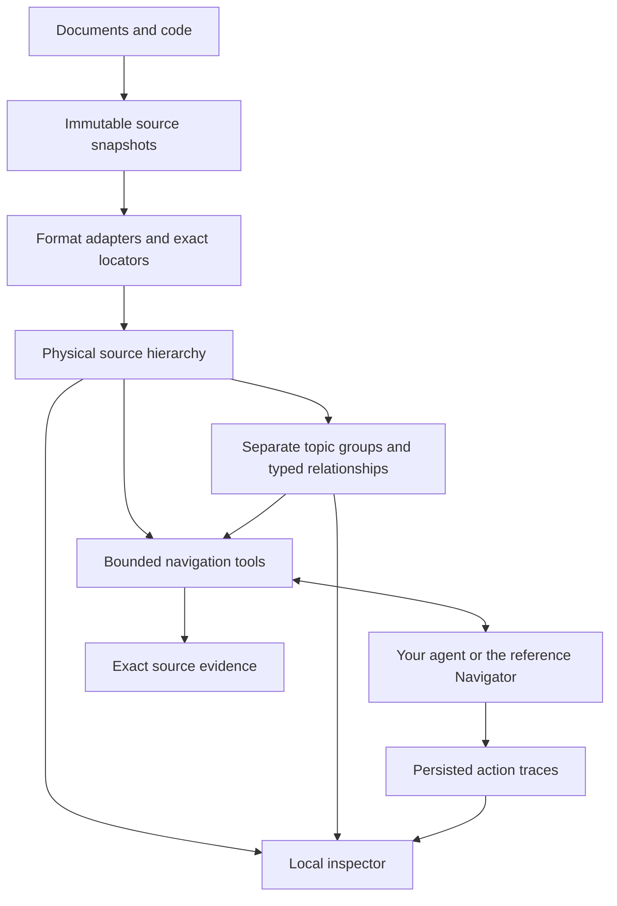

# Navconr: technical README

Navconr is a Python library for bounded navigation over versioned knowledge collections. It separates navigation maps from evidence: maps help an agent choose where to look; reads return exact bytes from immutable source snapshots or explicitly identified extraction artifacts.

[Main README](README.md) · [API guide](docs/API.md) · [Current status](docs/STATUS.md) · [MIT license](LICENSE)

Navconr embeds in existing Python projects without selecting a model or SDK. Keep your own agent loop and use `AgentTools`, or connect an existing async client with `CallableProvider`. The [integration guide](docs/INTEGRATION.md) covers both paths, OpenAI/Anthropic client mappings, and CLI provider factories. Other languages can connect through MCP.

## Architecture



The core uses SQLite/FTS5, Pydantic records, and format adapters. The inspector is a separate React/React Flow application. The library does not require a web server, graph database, agent framework, or model endpoint.

| Object | Contract |
| --- | --- |
| Source revision | Immutable original bytes and source identity |
| Extraction artifact | Versioned extracted text linked to the original source and adapter configuration |
| Span | Exact range in a named source revision or extraction artifact |
| Node | Navigation entry with zero or more span references; multiple nodes may share spans |
| Edge | Typed relationship with parsed, manual, similarity, or LLM-inferred provenance |
| Index revision | Atomically published collection state, including map and search membership |
| Session | Pinned revision, shared budget, and recorded tool actions |

Physical parents remain separate from semantic groups. Titles, summaries, groups, and inferred relationships are navigation aids; they cannot replace source evidence or invent valid locators.

## Installation

Python 3.11+ is required. Install the core from this repository with [uv](https://docs.astral.sh/uv/getting-started/installation/):

```bash
git clone https://github.com/Twilight-Techy/navconr.git
cd navconr
uv sync --locked
```

For the development environment, format/search adapters, MCP, LangGraph, and viewer dependencies, install Node.js 22/npm and run:

```bash
make setup
```

Optional Python extras can also be selected individually, for example `uv sync --locked --extra formats --extra search`:

| Extra | Adds |
| --- | --- |
| `formats` | PDF, DOCX, HTML, and TypeScript/TSX parser dependencies |
| `search` | NumPy/scikit-learn for TF-IDF vector and hybrid retrieval |
| `embeddings` | Optional sentence-transformer encoder; model weights may download on use |
| `mcp` | MCP stdio server |
| `langgraph` | LangGraph workflow and LangChain tools |
| `research` | Plotting dependencies for research artifacts |
| `dev` | Test, lint, typing, and build tools |

After selecting extras, use `.venv/bin/python`, `.venv/bin/navconr`, or `uv run --no-sync` to retain that environment. A subsequent plain `uv sync` or `uv run` can remove unselected extras.

## Python: navigate and read

Use a session to pin a revision and share one budget across operations:

```python
from navconr import Index, Limits

with Index(".navconr/demo.sqlite") as index:
    index.ingest("examples/corpus")
    session = index.session(limits=Limits(source_bytes=4096, steps=32))
    candidates = session.search("refresh token revocation")
    for card in candidates.items[:2]:
        for item in session.read(card.span_ids):
            if item.evidence:
                print(item.evidence.span.source, item.evidence.text)
```

`Index.overview/search/expand/follow/read` convenience methods each start a fresh session. Keep an explicit session when composing tools under a shared limit.

| Tool | Purpose |
| --- | --- |
| `overview` | Bounded cards for a physical or semantic view |
| `expand` | Batched physical children or semantic group members |
| `search` | Ranked source-block cards; optional mode and scope |
| `follow` | Relationships, including inverse traversal, relation/origin filters, and unresolved targets |
| `read` | Exact spans or explicitly requested absolute-byte subranges; per-item errors |

Map tools accept pagination and byte bounds. Repeat the same arguments with the returned cursor; changing the operation, revision, query, limit, or byte bound invalidates it. A page that cannot fit one card fails explicitly. Reads never silently shorten evidence.

For original UTF-8 text, byte offsets are zero-based and end-exclusive. Displayed line ranges are one-based and inclusive. PDF/DOCX/HTML/notebook text locators refer to named extraction artifacts, not byte offsets in the original container file. See [adapter contracts](docs/ADAPTERS.md).

## Reference retrieval controller

`Navigator.retrieve` is async and returns evidence, revision, usage, trace, and a structured stop reason:

```python
import asyncio

from navconr import Index, Limits
from navconr.navigation import Navigator

async def retrieve():
    with Index(".navconr/demo.sqlite") as index:
        index.ingest("examples/corpus")
        result = await Navigator(index).retrieve(
            "refresh token revocation",
            limits=Limits(source_bytes=4096, steps=64, seconds=30),
        )
        print(result.stop_reason, result.usage)
        for evidence in result.evidence:
            print(evidence.text)

asyncio.run(retrieve())
```

Inside an existing event loop, use `await retrieve()`. SQLite operations are synchronous and an `Index` owns one connection; use independent connections across threads. Provider operations are async and support cancellation/deadlines.

The default `fixed` policy and experimental `adaptive` budget heuristic run without a model. The `model` policy requires an explicit provider. `completed` means the policy stopped; it does not prove that every relevant passage was found. Other reasons include insufficient evidence, budget exhaustion, deadline, cancellation, and failure.

Search modes are lexical FTS5/BM25, sparse TF-IDF vector search, reciprocal-rank hybrid search, and semantic search with an explicitly supplied encoder. TF-IDF is the default vector representation. `SentenceEncoder` from `navconr.search` needs the `embeddings` extra and may download weights; pin a model revision for reproducibility.

Optional Ollama navigation, with an endpoint and model you have already configured:

```bash
.venv/bin/navconr query "your question" --db .navconr/demo.sqlite \
  --policy model --model your-installed-ollama-model \
  --endpoint http://127.0.0.1:11434
```

This sends query/map/evidence content to the selected endpoint. Navconr does not start Ollama or install models. Optional enrichment and answer synthesis are described in the [API guide](docs/API.md). Citation-ID validation establishes valid references, not claim entailment. A [single-passage Claude answer smoke test](reports/anthropic-smoke.json) passes; model-directed navigation and broader research validation remain pending.

## Budgets and provenance

An opt-in Claude Messages adapter is available as `navconr.anthropic.AnthropicProvider`. It uses low effort, small configurable input/output caps, a free token-count preflight and no automatic retries. See the [Claude integration guide](docs/API.md#minimal-claude-integration) and [recorded smoke result](reports/anthropic-smoke.json). Routine tests never invoke it with real credentials.

`Limits` bounds source bytes, map bytes, steps, expansions, model calls/tokens, retries, and elapsed time. Source and map byte usage are exact; model-token estimates are identified separately. The Ollama adapter reserves estimates before requests, limits outputs through the provider, reconciles reported usage, and charges failures conservatively. It rejects a requested hard token cap because it has no trusted preflight tokenizer.

Sessions share one ledger across calls. Traces record safe arguments, selected objects, returned spans, timing, usage, and stop reasons. They do not require private model reasoning. Preserve traces and source snapshots when citations must remain replayable; consider indexed content and provider endpoints when deciding what data to share.

## Storage and operations

SQLite database schema **2** stores immutable snapshots and revision-local FTS membership. Schema **1 → 2** migration and rollback are tested. Record/tool/trace JSON remains schema **1**; `navconr schemas` exports record schemas. Compatibility is still subject to development-release changes.

Unchanged inputs with matching configuration reuse source parsing. Publication is atomic. Metadata and FTS membership are rebuilt per revision, so incremental ingestion does not imply logarithmic indexing costs.

```bash
.venv/bin/navconr verify --db .navconr/demo.sqlite
.venv/bin/navconr backup .navconr/demo-backup.sqlite --db .navconr/demo.sqlite
```

Retention pins, trace references, garbage collection, backup/restore, and source-root restrictions are covered in [operations](docs/OPERATIONS.md). Review retention before removing historical evidence. Source discovery excludes hidden/generated/runtime paths and symlinks escaping the configured root.

## Inspector and agent integrations

```bash
.venv/bin/python scripts/prepare_demo.py
npm --prefix viewer ci
npm --prefix viewer run build
.venv/bin/navconr serve --db .navconr/demo.sqlite
```

The local inspector at `http://127.0.0.1:8765` exposes source/topic views, relationship-origin filters, exact evidence, and stored retrieval traces. It does not initiate model calls. The release script bundles built assets in the Python wheel.

The framework-neutral `AgentTools` interface exposes session lifecycle, JSON tool schemas, and the five navigation operations. Install the `langgraph` extra for `langchain_tools(index)` and `retrieval_graph(index)`. Run `.venv/bin/python examples/langgraph_context.py` for the model-free reference workflow.

With the `mcp` extra installed, configure a stdio client with absolute executable/database paths:

```json
{
  "mcpServers": {
    "navconr": {
      "command": "/absolute/path/to/navconr/.venv/bin/navconr",
      "args": ["mcp", "--db", "/absolute/path/to/index.sqlite"]
    }
  }
}
```

## Development and verification

```bash
make setup
make check
cd viewer
npx playwright install chromium
npm test
```

`make check` runs Ruff, formatting, mypy, Python tests, and the viewer build. Browser tests prepare their own sample database. Routine checks use local fixtures and fake providers. Real-provider calls and model downloads are opt-in. One minimal Claude answer smoke test is recorded; broader model checks remain pending. The paid smoke script is excluded from ordinary checks.

Run authored software evaluations with `make benchmark`, then optionally the second partition:

```bash
.venv/bin/navconr evaluate benchmarks/dataset.json \
  --db .navconr/benchmark.sqlite --split heldout
```

The recorded software comparisons use 70 authored questions, nine methods, and two budgets, producing 1,260 rows across two partitions. These check implementation behavior; they do not establish independent research validity, answer quality, novelty, or superiority. See [evaluation](docs/EVALUATION.md), [status](docs/STATUS.md), and the [preliminary manuscript](paper/manuscript.md).

## Build and license

Run `.venv/bin/python scripts/release.py` to build the viewer and wheel/source distribution and record artifact hashes. It does not upload packages. Package-registry identity, dependency/asset review, independent research gates, and paper submission remain separate work.

Navconr is [MIT licensed](LICENSE). Python and inspector metadata declare MIT; Python distributions and research bundles include the license. Dependencies retain their own licenses and notices. [Release guidance](docs/RELEASE.md) covers artifact checks and publication boundaries.
