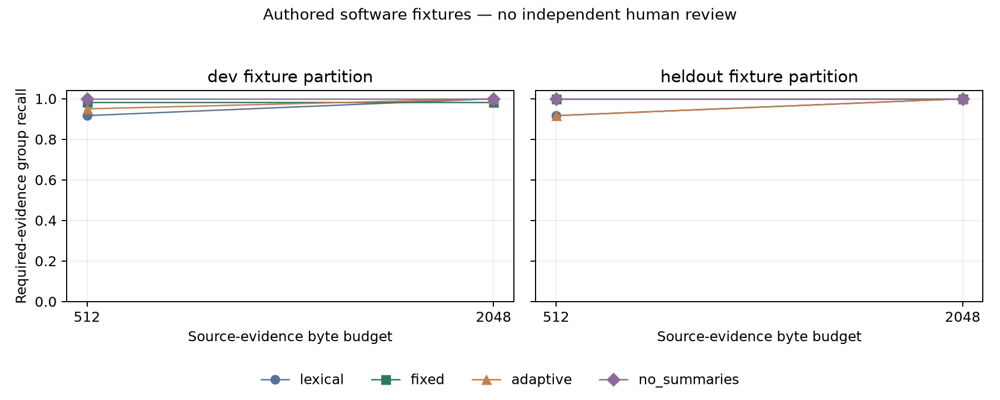

# Navconr: Inspectable Progressive Retrieval with Versioned Source Evidence

**Preliminary implementation manuscript. Authorship, independent review, final research claim, and submission venue are pending.**

## Abstract

We describe a local library that separates bounded navigation maps from exact source evidence. It provides immutable snapshots, hierarchical exploration, explicit and inferred relationship provenance, shared retrieval budgets, and replayable action traces. We exercise the implementation using authored fictional documentation and local retrieval baselines. These experiments verify software behavior and expose tradeoffs; they do not establish novelty, generalization, or superiority over existing retrieval systems. Broader real-model evaluation and the independent research study remain pending.

## 1. Motivation and related work

An agent working over a large collection can first inspect a compact map, request finer views, and then read original evidence. The map must itself be bounded as the collection grows. This architectural pattern overlaps substantially with [PageIndex](https://github.com/VectifyAI/PageIndex), [RAPTOR](https://arxiv.org/abs/2401.18059), [recursive node-reference retrieval](https://developers.llamaindex.ai/python/framework/integrations/retrievers/recursive_retriever_nodes/), [GraphRAG DRIFT](https://microsoft.github.io/graphrag/query/drift_search/), [IRCoT](https://arxiv.org/abs/2212.10509), and the [NavTree preprint](https://arxiv.org/abs/2610.06902). We make no claim to have originated hierarchical or agentic retrieval. An architectural review is available in the related-work matrix.

## 2. Representation and implementation

Sources are immutable content-addressed bytes. Converted formats produce separately identified extraction artifacts linked to their originals. A span specifies an exact half-open byte interval within one source/artifact revision. Navigation nodes can reference several spans, and several nodes can reference the same span. Physical hierarchy is kept separate from semantic groups and typed relationships. Relationships preserve parsed/manual/similarity/inferred origin, including unresolved and stale targets.

The local implementation uses Python, Pydantic, Markdown structural parsing, SQLite, and FTS5. Each immutable index revision has its own FTS statistics so retained historical corpora cannot alter its rankings. Optional adapters cover text-based PDF pages, Python/TypeScript structure, HTML, DOCX and notebook source cells. Optional search supports lexical TF-IDF vectors and sentence-transformer embeddings. The default sparse vector baseline is lexical; it is not a learned semantic model. The inspector and MCP transport consume the same public tools.

## 3. Retrieval and budget policies

The tool surface exposes overview, expansion, search, reference following and exact reads. Each session pins a revision and accounts for map bytes, evidence bytes, steps, expansions, deadlines and model usage. Large responses are paged or rejected; evidence is never silently shortened. The fixed local policy explores a bounded frontier and uses global search for recovery. The adaptive local variant changes exploration effort using the source budget and observed evidence gain; it is a heuristic rather than a learned policy. Optional model-directed navigation is implemented but not evaluated with a live model in this artifact.

Model adapters reserve estimated capacity and reconcile reported usage. The current Ollama adapter has no trusted preflight tokenizer, so it refuses a requested hard total-token guarantee. Failed requests are charged conservatively. Action traces record observable calls and outputs rather than hidden reasoning.

## 4. Software evaluation protocol

The authored fixture contains 70 questions across ten fictional service-document families. Five families belong to each software-test partition. Questions include direct lookup, cross-document evidence, and deliberately out-of-vocabulary unanswerable cases. Passage labels are machine checked; independent human annotation review has not occurred. Queries contain substantial lexical overlap with their evidence. The split is a software verification device and is not presented as an independently validated scientific held-out study.

We run nine local methods at source-evidence limits of 512 and 2,048 bytes: lexical retrieval, TF-IDF cosine, reciprocal-rank hybrid, parent-child expansion, structural-only navigation, fixed navigation, adaptive navigation, and no-summary/no-reference ablations. Required-group recall accepts a valid alternative passage for each group. Complete-evidence success requires all groups. Runtime failures and budget violations remain visible. No common live answer reader, semantic model evaluation, or upstream-method execution is included in these results.

## 5. Recorded local results

| Partition | Method | Source bytes | Evidence recall | Complete evidence | Failures |
| --- | --- | ---: | ---: | ---: | ---: |
| dev | lexical | 512 | 0.917 | 0.833 | 0 |
| dev | lexical | 2048 | 1.000 | 1.000 | 0 |
| dev | vector | 512 | 0.917 | 0.833 | 0 |
| dev | vector | 2048 | 1.000 | 1.000 | 0 |
| dev | hybrid | 512 | 0.917 | 0.833 | 0 |
| dev | hybrid | 2048 | 1.000 | 1.000 | 0 |
| dev | parent_child | 512 | 0.917 | 0.833 | 0 |
| dev | parent_child | 2048 | 0.983 | 0.967 | 0 |
| dev | structural | 512 | 0.967 | 0.933 | 0 |
| dev | structural | 2048 | 0.967 | 0.933 | 0 |
| dev | fixed | 512 | 0.983 | 0.967 | 0 |
| dev | fixed | 2048 | 0.983 | 0.967 | 0 |
| dev | adaptive | 512 | 0.950 | 0.900 | 0 |
| dev | adaptive | 2048 | 1.000 | 1.000 | 0 |
| dev | no_summaries | 512 | 1.000 | 1.000 | 0 |
| dev | no_summaries | 2048 | 1.000 | 1.000 | 0 |
| dev | no_references | 512 | 0.967 | 0.933 | 0 |
| dev | no_references | 2048 | 0.967 | 0.933 | 0 |
| heldout | lexical | 512 | 0.917 | 0.833 | 0 |
| heldout | lexical | 2048 | 1.000 | 1.000 | 0 |
| heldout | vector | 512 | 0.917 | 0.833 | 0 |
| heldout | vector | 2048 | 1.000 | 1.000 | 0 |
| heldout | hybrid | 512 | 0.917 | 0.833 | 0 |
| heldout | hybrid | 2048 | 1.000 | 1.000 | 0 |
| heldout | parent_child | 512 | 0.917 | 0.833 | 0 |
| heldout | parent_child | 2048 | 0.967 | 0.933 | 0 |
| heldout | structural | 512 | 1.000 | 1.000 | 0 |
| heldout | structural | 2048 | 1.000 | 1.000 | 0 |
| heldout | fixed | 512 | 1.000 | 1.000 | 0 |
| heldout | fixed | 2048 | 1.000 | 1.000 | 0 |
| heldout | adaptive | 512 | 0.917 | 0.833 | 0 |
| heldout | adaptive | 2048 | 1.000 | 1.000 | 0 |
| heldout | no_summaries | 512 | 1.000 | 1.000 | 0 |
| heldout | no_summaries | 2048 | 1.000 | 1.000 | 0 |
| heldout | no_references | 512 | 0.967 | 0.933 | 0 |
| heldout | no_references | 2048 | 0.967 | 0.933 | 0 |

Each partition contains 630 recorded method/question/budget combinations. The complete source manifests and per-question rows accompany the reproduction bundle. Metrics are descriptive software-smoke measurements. They are not estimates of performance on real user corpora. No significance, answer-quality, or novelty claim follows from this table.

Figure: selected methods at the two tested source budgets; the full method table is above. No model-dependent results are implied.

## 6. Operational verification

Regression tests cover byte fidelity, Unicode/CRLF, source revisions, failed publication rollback, explicit links, code scope, multi-page extraction locators, response paging, budget reservations, retry limits, cancellation, traces, agent schemas, MCP transport and local API boundaries. A separate corpus-growth check exercises 100, 500 and 1,000 generated documents and verifies bounded map pages. Whole-revision metadata is loaded into host memory, so bounded model context is not a claim of sublinear host resource use. Update reuse avoids reparsing unchanged sources, but metadata and FTS membership are rebuilt per published revision.

## 7. Limitations and remaining study

The corpus is fictional, authored by the implementation process, lexically easy, and small. Its unanswerable queries are artificial. Passage containment is not a substitute for human relevance judgments or citation entailment. The local policies have deterministic ordering and limited exploration. Sparse vector comparisons do not substitute for strong learned embeddings and rerankers. Original PageIndex/RAPTOR/NavTree runs, independently reviewed data, multiple real corpora/models, common-reader answer evaluation, repeated-cost analysis and independent reproduction are still required. One minimal Claude API cited-answer smoke check is recorded separately; broader live-model research evaluation remains pending. The software is MIT licensed; paper author identity and venue remain unresolved.

## 8. Reproduction

Install the locked environment, generate fixtures, ingest the fixture corpus and run both software partitions using the documented evaluator. Raw manifests identify source revisions, code hash, package versions, configuration and cache assumptions. The public task tracker distinguishes implemented code from pending acceptance gates. External prediction import can validate supplied source spans, but does not claim to have executed the upstream system.

The research question remains: under fixed total budgets, when does progressive navigation improve evidence coverage and answer quality compared with strong search? The current artifact supplies an implementation and a test harness for that study; it does not supply the missing independent evidence.
